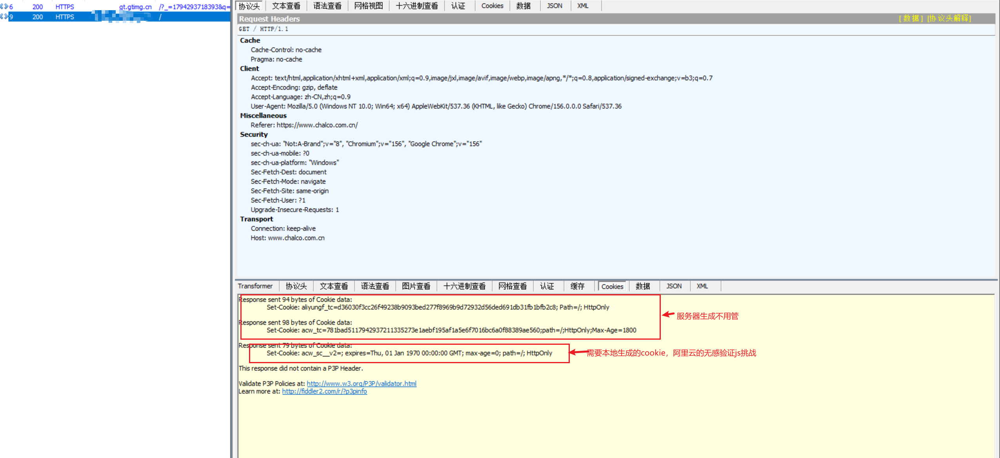
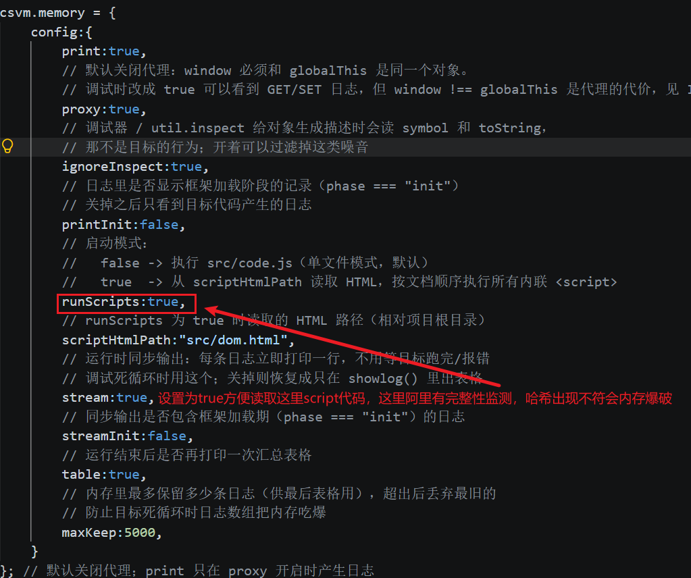
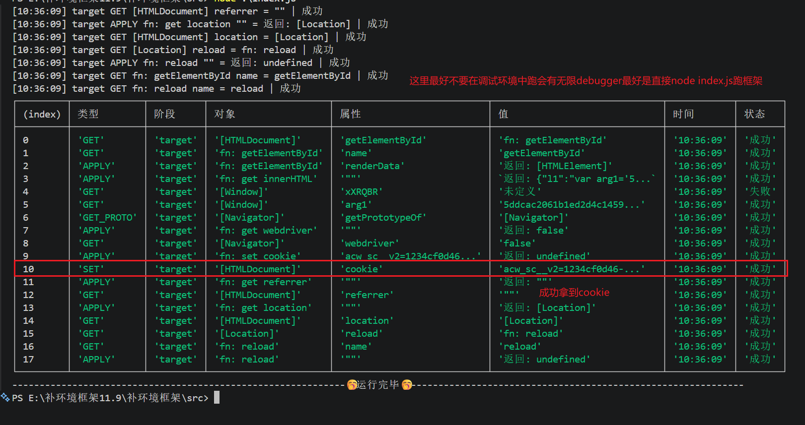

## 阿里云Web应用防火墙JS挑战
### 抓包分析

set了两段cookie，第三个cookie：acw_sc_v2则是前端计算完毕后设置
### 框架设置

这里有代码完整性监测将这里的script扣下来执行回有内存爆破的问题这里直接通过dom树来依次执行script标签中的js代码
### 结果

这里旧不放请求成功了，到这里旧已经完成了，还有需要注意的一点就是无限debugger，测试中用node直接执行会好很多

## 框架仓库：https://github.com/0rzOday/csVM2